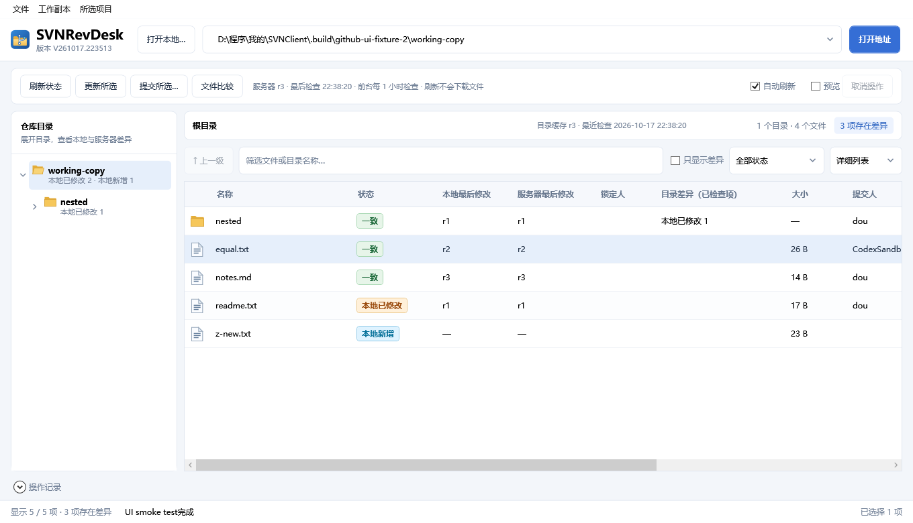
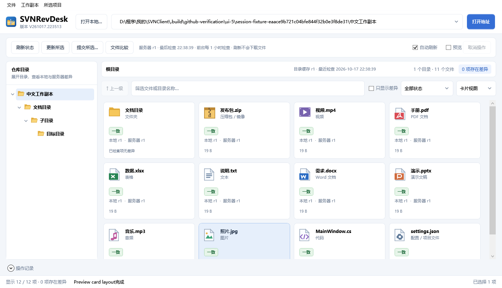
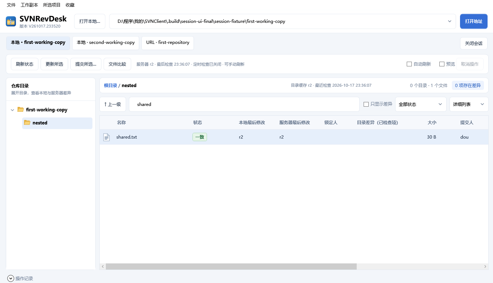
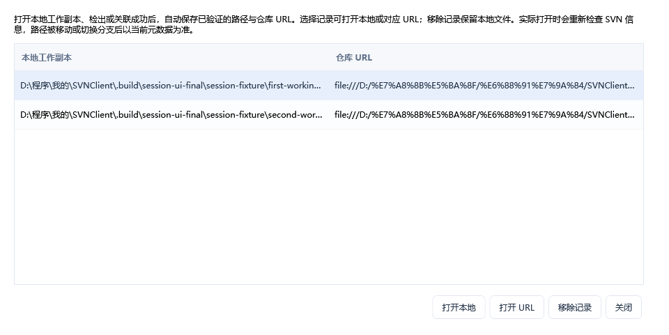
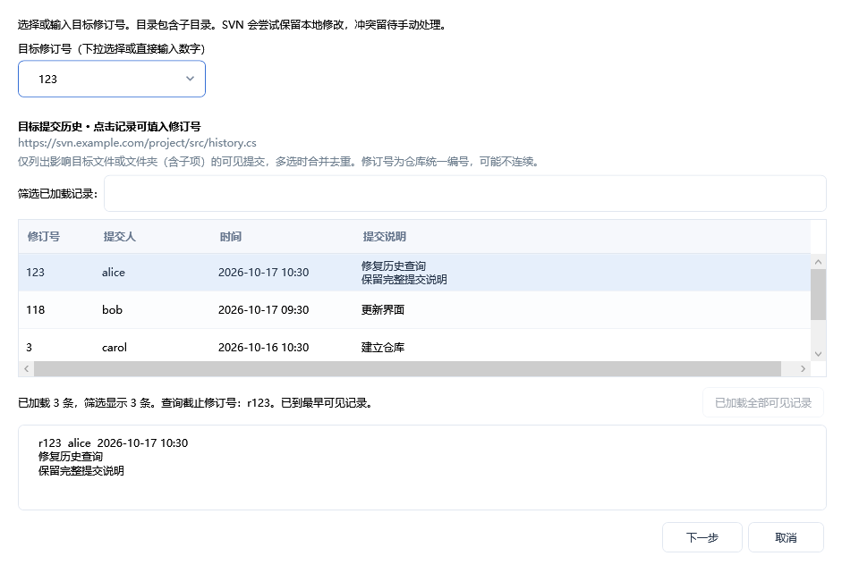
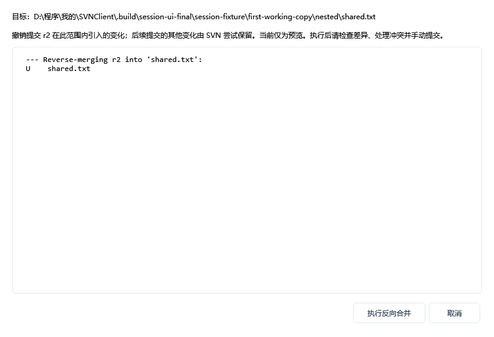
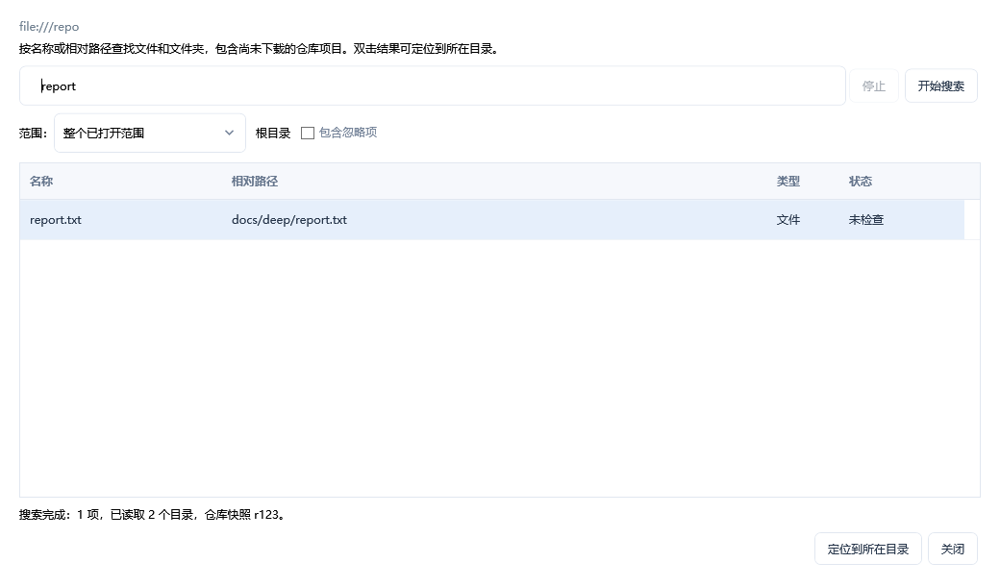
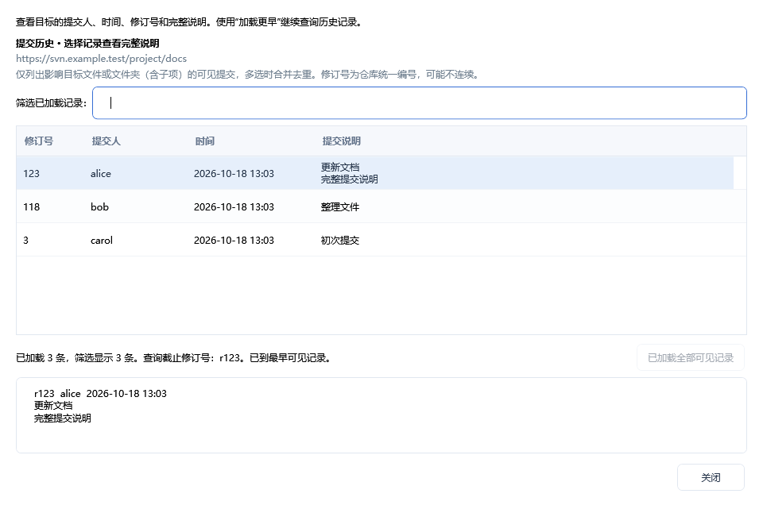
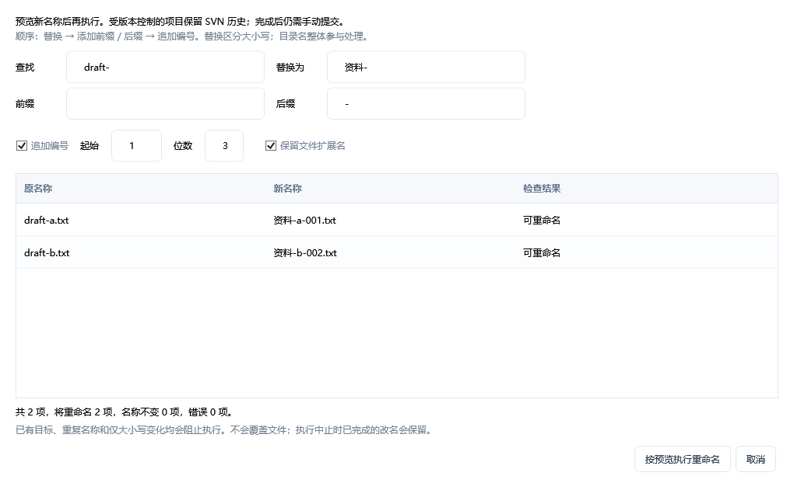

<div align="center">


# SVNRevDesk

**偏向文件管理的 Windows 中文 SVN 客户端**

以文件和文件夹为中心，在一个窗口中浏览仓库、整理文件、查看差异、选择历史版本并提交变更。

[](https://github.com/pi-dan/SVNRevDesk/releases/latest)
[](https://github.com/pi-dan/SVNRevDesk/actions/workflows/ci.yml)
[](LICENSE)


[下载 Releases](https://github.com/pi-dan/SVNRevDesk/releases) · [使用说明](docs/使用说明.md) · [更新日志](CHANGELOG.md) · [反馈问题](https://github.com/pi-dan/SVNRevDesk/issues)

</div>

## 项目定位

SVNRevDesk 侧重 SVN 仓库中的日常文件管理，适合管理文档、办公文件、设计素材等共享资料。用接近文件管理器的方式浏览目录、复制粘贴、剪切移动、新建和预览文件，同时查看本地与服务器的差异，按需更新并勾选提交。

版本操作围绕具体文件和文件夹展开：可以查看影响目标的提交历史、更新到指定修订号，或预览后回滚某次提交。多仓库页签、位置收藏、工作副本关联与本地备份，方便在多个资料库之间切换和整理文件。具体功能及当前覆盖范围见 [使用说明](docs/使用说明.md) 和 [功能检查](docs/功能检查.md)。

## 界面预览



<details>
<summary>查看卡片视图</summary>



</details>

<details>
<summary>多仓库会话、关联列表与回滚预览</summary>









</details>

## 主要功能

以下以当前源码为准；尚未进入正式发布包的内容见[更新日志](CHANGELOG.md)。

| 功能 | 说明 |
| --- | --- |
| 文件管理 | 复制粘贴、剪切移动、拖入拖出、单项 / 批量重命名，以及新建文本和 Office 文件；批量改名先预览、检查冲突，受控文件移动保留 SVN 历史。 |
| 跨目录搜索 | 独立窗口按名称或路径递归搜索当前目录或整个打开范围，包含在线 / 未下载项目，双击定位；支持停止和忽略项开关。 |
| 仓库与工作副本浏览 | 打开本地 SVN 工作副本或仓库 URL，支持关联已有副本、完整检出和稀疏检出。 |
| 多仓库与收藏 | 独立仓库页签、目录与选择状态保留、启动恢复；工作副本与 URL 长期关联列表、位置收藏及快捷切换。 |
| 差异一目了然 | 区分服务器更新、本地修改、双方修改、未下载、缺失、新增、删除和冲突；显示修订号、修改时间与锁定人。 |
| 文件比较与预览 | 内置 WinMerge，支持与服务器、BASE 和历史版本比较；可选图片、文本预览，也可配置外部比较工具。 |
| 勾选提交 | 独立提交窗口，明确选择要提交的项目；支持自动添加勾选的未受控文件。 |
| 常用 SVN 操作 | 更新、添加、删除、撤销、清理、锁定、冲突处理、历史、Blame、属性、导出、分支、标签、切换与合并。 |
| 指定版本与回滚 | 下拉选择或手动输入修订号，只列目标文件 / 目录的相关提交；按提交人 / 说明筛选历史、加载更早记录，更新到指定版本或预览后回滚单次提交。 |
| 提交历史浏览 | 独立历史窗口按 100 条分页，显示作者、时间与完整说明，筛选已加载记录；文件 / 目录 / 多选均按目标范围查询。 |
| 仅本机忽略 | 忽略规则只对当前 Windows 用户生效；忽略项仍可见，不计入差异和提交候选。 |
| 缓存与备份 | 恢复上次浏览位置，缓存优先启动，按目录刷新；服务器覆盖前备份，支持保留时间和清理管理。 |
| 便携使用 | 内置 SVN 与 WinMerge；设置、缓存、备份和工具存放在程序目录，支持系统托盘。 |

<details>
<summary>跨目录搜索、历史浏览与批量重命名（开发版）</summary>







</details>

## 下载与运行

打开 **[Releases 下载页](https://github.com/pi-dan/SVNRevDesk/releases/latest)**，按需选择 Windows x64 ZIP：

| 发布包 | 运行要求 | 功能 |
| --- | --- | --- |
| `SVNRevDesk-v版本号-win-x64-with-runtime.zip` **自带运行时版** | 无需另外安装 .NET，解压后运行。 | 完整功能 |
| `SVNRevDesk-v版本号-win-x64-without-runtime.zip` **不带运行时版** | 需要 [.NET 10 Desktop Runtime（Windows x64）](https://dotnet.microsoft.com/zh-cn/download/dotnet/10.0)。 | 完整功能 |

两个版本仅在是否附带 .NET 运行时上存在区别，均内置 SVN 与 WinMerge。具体文件大小和 SHA-256 校验值见对应 Release。

1. 将 ZIP 解压到有写入权限的文件夹，例如 `D:\Apps\SVNRevDesk`。
2. 运行 `SVNRevDesk.exe`；打开本地工作副本，或输入 SVN 仓库 URL。
3. 按需关联 / 检出本地副本，选择文件进行更新、比较和提交。

支持 Windows 10 / 11 x64。首次使用会在程序旁释放内置工具，因此请先解压，不要在 ZIP 内直接启动。升级时退出程序，再用新版文件覆盖；保留原有设置、缓存和备份目录。详细流程见 [使用说明](docs/使用说明.md)。

当前内置 SVN 的非 ASCII 路径处理受 Windows 系统代码页影响；中文路径已在中文区域环境验证，英文 Windows 建议使用英文目录和文件名。

## 从源码编译

安装 [.NET 10 SDK](https://dotnet.microsoft.com/zh-cn/download/dotnet/10.0)，在 Windows x64 上运行：

```powershell
git clone https://github.com/pi-dan/SVNRevDesk.git
cd SVNRevDesk
dotnet build SVNRevDesk.slnx -c Release
dotnet run --project src/SVNRevDesk.Desktop -c Release
```

仓库已包含第三方工具及对应许可文件，无需另外安装 SVN 客户端即可构建和运行主程序。

生成两种发布包及 SHA-256 校验文件：

```powershell
pwsh ./scripts/Publish-Release.ps1 -Version 1.1.0
```

测试、目录结构和自动发布流程见 [开发与发布](docs/开发与发布.md)。

## 许可与第三方组件

SVNRevDesk 自有代码采用 [Apache License 2.0](LICENSE)。内置的 SlikSVN、WinMerge 及其依赖分别遵循各自许可；WinMerge 以独立进程运行，其对应完整源码随内置分发一同提供。详见 [第三方声明](THIRD-PARTY-NOTICES.md)。

## 反馈与贡献

欢迎通过 [Issues](https://github.com/pi-dan/SVNRevDesk/issues) 提交问题或建议。报告问题时请附上程序版本、Windows 版本、复现步骤及必要的脱敏日志。提交代码前请阅读 [贡献说明](CONTRIBUTING.md)。
