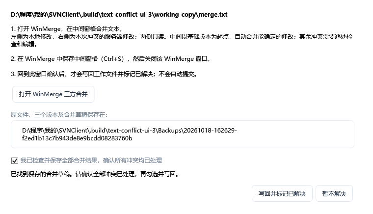

# 使用说明

SVNRevDesk 是偏向文件管理的 Windows 中文 SVN 客户端。主要围绕文件和文件夹完成浏览、整理、预览、比较、更新及提交，适合日常管理文档、办公文件、设计素材等共享资料。

## 选择发布包

前往 [Releases](https://github.com/pi-dan/SVNRevDesk/releases/latest)。两个版本功能完全相同，均包含 SVN 与 WinMerge：

- **自带运行时版**：文件名带 `with-runtime`，无需另外安装 .NET。
- **不带运行时版**：文件名带 `without-runtime`，需先安装 [.NET 10 Desktop Runtime，Windows x64](https://dotnet.microsoft.com/zh-cn/download/dotnet/10.0)。注意选择 **Desktop Runtime / 桌面运行时**。

将 ZIP 完整解压到可写目录，运行 `SVNRevDesk.exe`。初次调用 SVN / 比较功能时，会自动释放相应工具到程序旁的 `Tools` 目录。

## 打开仓库

- **已有工作副本**：打开包含 `.svn` 元数据的本地工作副本目录。
- **只有仓库地址**：输入 `https://...` 等 SVN URL 在线浏览；需要修改、提交时，再关联已有副本或执行检出。
- **只下载部分内容**：选择稀疏检出，之后对需要的文件 / 目录执行更新。

在线浏览且未关联本地时，界面显示“未检查”，此时不能确定本地与服务器差异。

## 多仓库、收藏与关联列表

打开其他工作副本或仓库 URL 会创建新页签；重复打开同一位置会切换到已有页签。本地副本和它对应的在线 URL 分别作为独立会话。切换时保留目录、筛选和选择。执行 SVN 写操作时暂时不能切换或关闭会话。

通过“文件 → SVN 登录…”输入账号密码，默认勾选“记住密码”，凭据按地址加密保存在程序旁的 `Credentials` 目录，重启后自动读取，仅原 Windows 用户可解密。取消勾选并确认可清除该地址已保存的凭据。升级时保留 `Credentials` 目录。

点击页签或使用 Ctrl+Tab / Ctrl+Shift+Tab 切换；Ctrl+W 关闭当前会话，不会删除工作副本。退出时保存所有打开的仓库和目录；下次启动先恢复当前会话，其余会话在选中时载入。

“收藏 → 收藏当前位置”保存当前仓库及所在子目录；也可以手工添加工作副本路径或 URL。收藏菜单支持打开、重命名和移除。

成功打开本地工作副本、检出或关联后，会保存已校验的本地路径、仓库 URL 和仓库标识。通过“文件 → 工作副本与 URL 关联列表”查看这些长期记录，选择“打开本地”或“打开 URL”即可切换，也可移除记录。即使关闭仓库页签，关联记录仍保留；重新打开时会检查实际 SVN 元数据，切换分支后更新记录。

## 当前目录地址与本地位置

当前路径右侧有两个图标按钮：复制图标将当前目录的本地磁盘路径复制到剪贴板；文件夹图标在资源管理器中打开当前本地目录。悬停可查看路径，切换目录及页签后随之更新。未映射到本地磁盘时，点击复制会弹出提示，需先关联本地工作副本或检出到本地；本地目录不存在或无法访问时同样提示，不改动剪贴板。纯在线目录或尚未下载的目录无法直接打开本地位置，需先关联或下载。

## 更新当前层文件

主页工具栏点击“更新当前层文件”，将当前浏览目录中的文件更新到服务器最新版本，不更新子目录及其中的文件。无需选择项目，也不受名称、状态或“只显示差异”筛选影响；已经最新的文件无需重新下载，服务器新增或本地缺失的文件也会下载到当前目录。纯在线浏览时需先关联本地工作副本。

SVN 会尝试保留未提交的本地修改，冲突留待手动处理，不会强制覆盖或自动提交。对深度为空的稀疏目录，操作会将该目录扩展到“仅文件”深度；已有子目录不会因此下载。操作完成后刷新当前层状态，已有搜索索引在后台核对。

## 指定版本更新与回滚提交

在文件 / 目录右键菜单选择“更新到指定修订号”；“工作副本”菜单也可对当前目录执行。弹窗中可以下拉选择、点击历史记录，或直接输入数字修订号，再点“下一步”确认。目录包含子项，文件只更新自己。SVN 尝试保留本地修改，冲突留待手动处理；此操作不创建服务器提交，之后可用“更新到最新”返回最新版本。

修订号选择窗口只读取**影响目标文件或文件夹的提交**：文件只列自身历史，文件夹包含子项的变化；多选时合并这些目标的历史，同一次提交只显示一条。当前目录操作按当前目录查询，目录树操作按右键目标查询。窗口会显示历史范围、修订号、提交人、时间和说明，点击记录可查看完整说明。先加载最近 100 条相关记录，点“加载更早的 100 条”可继续翻阅到最早可见记录；筛选框按修订号、提交人、时间或说明筛选**已加载**的记录。SVN 修订号在整个仓库中递增，因此目标的历史编号可能不连续。手动输入不受已加载列表限制；读取失败时可重试，也可直接输入，修订号是否存在由 SVN 执行时检查。

“回滚指定提交（反向合并）”撤销某一次提交在所选文件或目录范围内引入的变化。先更新目标到最新并处理未提交修改，再在同样的修订号选择窗口中选择或输入要回滚的提交。程序先显示 SVN 合并预览；取消不会改变工作副本。确认后通过反向合并生成本地修改，不删除服务器历史，也不会自动提交。请检查差异、解决冲突，再提交回滚结果。

程序在预览和执行前都会重新检查本地状态。目标范围内有内容 / 属性修改、未受控文件、缺失或冲突等状态时拒绝回滚，保留已有数据。SVN 对混合修订工作副本的限制仍适用，需先更新目标目录。含 `@` 且与切换后的仓库文件名不同的文件，请改在上级目录执行反向合并。

## 查看与处理差异

目录树用于导航，右侧支持详细列表和卡片。可以按名称或状态筛选，或只显示差异。界面区分一致、服务器有更新、本地已修改、双方均有修改、本地未下载、本地缺失、本地新增、本地已删除、服务器已删除、冲突、已忽略及未检查。

服务器状态以最近一次检查为准。默认每小时自动检查打开范围，可在设置中调整；F5 手动检查当前目录。右键菜单提供更新、比较、历史、属性、导出等操作。

## 文本冲突合并

当更新或合并使文本文件显示为“冲突”时，右键该文件选择“解决冲突…” → “用 WinMerge 合并文本…”。此入口仅处理文本内容冲突，使用内置 WinMerge，不受自定义双文件比较工具设置影响。

1. 点击“打开 WinMerge 三方合并”。左侧为冲突前的本地修改，右侧为本次冲突的服务器修改，两侧只读；中间以共同基础版本为起点，自动合并能确定的变化，其余冲突需逐处检查和编辑。这里使用 SVN 保存的冲突版本，不下载后来的 HEAD。
2. 在 WinMerge 中检查中间窗格，按 Ctrl+S 保存合并结果，然后关闭本次 WinMerge 窗口。结果先写入独立草稿，此时工作副本仍保持原样。再次打开时继续编辑已保存的草稿。
3. 回到客户端，勾选“我已检查并保存全部合并结果，确认所有冲突均已处理”，点击“写回并标记已解决”。程序检查原文件和冲突状态是否变化、结果是否残留冲突标记；通过后写回并清除该文件的 SVN 冲突状态。合并结果仍是本地待提交修改，检查后再手动提交。

原工作文件、基础版本、本地版本、服务器版本和合并草稿保存在窗口显示的 `Backups` 子目录，遵循备份保留设置。点击“暂不解决”不会写回或标记解决；若 WinMerge 仍在编辑，客户端停止等待但不会强制终止编辑器。保留备份路径可查找已保存的草稿。

每个版本暂限 20 MiB，支持可识别的 UTF-8、带 BOM 的 UTF-16 / UTF-32 及 GB18030 文本；写回保留草稿的原始字节和换行。二进制文件、SVN 属性冲突和目录树冲突不进入此流程，原有手工处理入口仍保留。自动检测无法代替人工检查合并内容。

## 跨目录搜索

点击筛选框旁的“跨目录搜索…”或按 Ctrl+Shift+F 打开独立搜索窗口。主界面筛选框只筛选当前目录；搜索窗口通过本机保存的文件清单查找整个打开范围。

1. 输入名称或相对路径的一部分，例如 `合同`、`.pdf` 或 `资料/会议`；不区分大小写，路径可使用 `/` 或 `\`。不支持通配符或文件内容搜索。
2. 默认范围为“整个已打开范围”，即当前仓库页签的打开根目录，不会跨到其他页签或上级仓库；也可切换为“当前目录及子目录”。
3. 首次打开时建立索引；之后输入即可搜索，也可点“开始搜索”。结果显示名称、相对路径、类型和状态，名称旁用图标区分文件夹、Office 文档、PDF、图片、压缩包等，悬停图标可查看类型说明；包含纯在线及稀疏副本中尚未下载的文件和本地未提交项目，未下载文件也显示图标。搜索不会下载文件或更改工作副本。
4. 双击结果、按回车或点“打开”：文件按主界面相同的规则打开，搜索窗口保持打开；文件夹则回到主界面并进入该目录。文件存在版本差异或尚未下载时，沿用打开版本选择；纯在线文件下载到只读临时文件后打开。
5. 右键结果可“打开”“定位到所在目录”“在资源管理器中显示”，也可复制相对路径、本地路径或仓库地址。定位操作回到主界面的父目录并选中该项，会清除主界面筛选条件，使目标可见；底部也保留定位按钮。纯在线项目不能在资源管理器中显示或复制本地路径。

默认跳过忽略项，可勾选“包含忽略项”查找其后代。搜索不进入链接目录、嵌套工作副本和 externals，请在独立页签打开实际副本后查询。每次最多显示 5000 项，达到上限时提示结果可能不完整。可点“停止”取消当前搜索或索引更新，保留已有结果和上次完整索引。

索引保存在程序目录的 `Cache/Search`，不会上传 SVN；每台电脑分别建立，同一电脑的不同工作副本及账号也分别缓存。首次通过 SVN 递归清单读取名称和元数据，耗时取决于仓库规模与网络；之后关键词仅匹配内存中的本地清单，不再逐目录请求服务器，也不搜索文件内容。

重新打开程序时，索引会完整核对本地已打开范围一次，以发现关闭期间的文件变化；首次加载与紧接着的刷新复用这次核对结果。服务器修订号未变化时复用原清单，有变化时按变化路径更新。后续手动刷新仍会重新核对本地变化。

打开搜索窗口会后台检查服务器；关闭窗口（含未选择结果直接关闭）后，被其他操作打断的后台索引核对会自动恢复，底部状态区继续显示“后台更新搜索索引”。已有索引会随主界面服务器检查同步更新：包括默认每小时一次的自动检查（需开启自动刷新，并满足主界面原有的活动 / 空闲条件），以及手动刷新。修订号不变时不重新列目录，有变更时按变化路径更新，范围较大时重新读取对应子树。本地新增、删除、改名及 SVN 元数据变化由文件监视器单独触发，通常在变化后约半秒开始核对，无需等到下一小时；程序内新建和移动完成后也会核对索引。

窗口显示索引项数、服务器修订号及服务器 / 本地核对时间。点“刷新索引”立即检查变化，点“重建索引”重新建立完整清单。后台检查期间仍可搜索已有缓存；连接失败会保留旧清单并显示错误及上次核对时间，因此搜索结果可能尚未包含服务器最新变更。首次尚无索引时，需要成功连接服务器后才能搜索完整范围。

## 浏览提交历史

选择文件或文件夹，右键“查看历史”；多选时合并目标的历史并按修订号去重。未选择项目时，“所选项目 → 查看历史”查询当前目录。目录树右键则只查询点击的目录及子项。

独立历史窗口先加载最近 100 条相关提交，点“加载更早的 100 条”继续翻阅。筛选框按修订号、提交人、时间或说明匹配**已加载记录**，点击记录查看完整提交说明。读取失败可重试，关闭窗口会取消未完成的查询。历史始终限于影响目标的提交，修订号可能不连续。需要更新或回滚时使用相应菜单入口。

## 提交与文件管理

“提交所选”或“提交当前目录”会打开独立提交窗口。勾选需要提交的项目、填写说明并确认；勾选未受控文件时，会先添加到版本控制。文件复制、粘贴、新建或移动不会自动提交。

软件内剪切、移动受控项目使用 SVN 移动以保留历史。服务器覆盖本地文件前会先确认并备份，可在备份管理中检查容量及清理；默认自动保留 30 天。

删除会先把现有文件内容备份到 `Backups`，再强制删除；本地修改、冲突、阻塞、替换、缺失和目录中的未受控文件均可处理，只读文件自动清除只读属性。本地文件不进入回收站；受控项目安排 SVN 删除，提交后才影响服务器。备份仅保存内容，不保存 SVN 属性和调度信息。打开的根目录、范围外路径、SVN 元数据、链接和嵌套工作副本仍受保护；文件被其他程序独占或权限不足时，需要解除占用或权限限制后重试。

本地未下载的文件和文件夹也可以删除。操作需要连接服务器准备目标的 SVN 信息；文件可能临时下载，文件夹只准备目录本身，不下载子项。删除后显示“本地已删除”，提交后才移除服务器上的文件或整个目录。

删除遇到 SVN 提示上一次操作未完成、需要 cleanup 时，会自动清理工作副本并重试一次，日志保留清理前的内容备份路径。若文件仍被占用导致清理失败，会显示实际原因和备份位置，不会循环重试。

### 批量重命名

在同一目录选择多个本地文件或文件夹，右键或通过“所选项目 → 批量重命名…”打开预览。项目按原名称排序，依次进行文本替换（区分大小写）、添加前缀 / 后缀、追加编号。默认保留文件扩展名；取消勾选后扩展名也参与规则。目录名称整体参与处理。编号的起始值和最小位数可调整，编号顺序与预览一致，名称不变的项目不会执行。

检查“原名称 / 新名称 / 检查结果”，再点“按预览执行重命名”。无效名称、重复名称、目标已占用及仅改变字母大小写会阻止执行；当前不支持直接交换名称。执行前再次检查文件和 SVN 状态，不覆盖已有项目。受控项目使用 SVN 移动并保留历史，普通文件仍为未受控；本地修改保留，完成后需要手动提交。中途取消或失败时，已完成的改名保留，请按刷新后的状态检查剩余项目。

“忽略（仅本机）”不会修改服务器 SVN 属性，规则仅供当前 Windows 用户使用。忽略项仍然显示，不计入差异或提交候选；若继承父目录的规则，需要在对应父目录取消忽略。

## 设置和数据位置

程序目录需要可写权限：

| 位置 | 内容 |
| --- | --- |
| `settings.json` | 设置、最近位置、打开的页签、收藏和工作副本 / URL 关联。 |
| `Cache/Sessions/` | 按本地路径或 URL 隔离的会话浏览缓存；兼容原有单会话缓存。 |
| `Backups/` | 本地文件备份。 |
| `Temp/` | 比较、预览等临时文件。 |
| `SvnConfig/` | SVN 配置和可能保存的认证信息。 |
| `Tools/` | 自动释放的 SVN 与 WinMerge。 |
| `%LOCALAPPDATA%\SVNRevDesk\local-ignores.json` | 当前 Windows 用户的本机忽略规则。 |

迁移程序时可保留程序旁的数据目录；本机忽略规则按用户和绝对路径保存，不随便携目录迁移。向他人分享时请使用 Releases 的干净 ZIP，避免将自己的配置、认证信息和备份一起发出。

## 快捷键

| 快捷键 | 操作 |
| --- | --- |
| 地址框 Enter | 打开输入位置。 |
| F5 | 刷新当前目录。 |
| Alt + ↑ | 上一级目录。 |
| Backspace | 上一级目录；输入框中仍用于删除字符。 |
| Ctrl + Tab / Ctrl + Shift + Tab | 下一个 / 上一个仓库页签。 |
| Ctrl + W | 关闭当前仓库会话。 |
| 文件列表 Enter | 打开所选。 |
| Ctrl + D | 比较所选文件。 |
| Ctrl + Shift + F | 打开跨目录搜索窗口。 |
| Ctrl + C / X / V | 复制 / 剪切 / 粘贴。 |

## 常见问题

- **启动提示安装 .NET**：下载自带运行时版，或安装 .NET 10 **桌面**运行时 x64。
- **无法保存配置或释放工具**：将程序移动到有写入权限的目录，退出后重新启动。
- **关闭后仍在运行**：程序支持最小化到托盘；通过托盘菜单退出，或在设置中调整关闭行为。
- **Office 比较插件无法工作**：部分 WinMerge 转换插件需要 Office 等外部软件；程序直接创建基础 Office 文档不依赖 Office。
- **连接特定服务器失败**：检查 URL、网络、证书、认证及仓库权限。自动化验证基于本地真实 SVN 仓库，具体服务器部署需按实际环境验证。
- **英文系统上中文路径报错或变成问号**：当前内置 SVN 命令行受 Windows 非 Unicode 程序语言 / 系统代码页限制。中文路径已在中文 Windows 区域环境验证；英文系统建议先使用英文目录和文件名。
